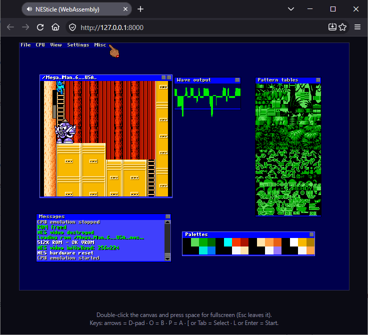

# NESticle → WebAssembly

A port of the leaked 1997 NESticle sources to the browser with Emscripten.

## Build and run

    source ~/emsdk/emsdk_env.sh           # emsdk 6.0.12 was used
    ./build.sh web                        # -> dist/
    python3 -m http.server -d dist 8000   # then open http://localhost:8000

Use the menus with the mouse; **Esc** toggles the menu bar over a running game. **File → Load ROM…**
opens the browser's native file chooser, and you can also drag-and-drop a `.nes`
onto the page. (Files stay in the browser's memory; nothing is uploaded.) Without the page hook, e.g.
in the headless tests, Load ROM falls back to NESticle's own dialog listing `*.nes` in the virtual FS.

Known quirk (original behaviour): NESticle offers every key to the controller before the menus, so the
default Keyboard 1 bindings shadow two menu hotkeys: `L` (Start) hides Load ROM's `l` and `P` (A button)
hides Pause's `p`. Use the menu, or remap the buttons under Settings → Redefine input.

Default game keys for player 1 (configurable under Settings): arrow keys, with Home/End/PgUp/PgDn
as diagonals; **O** = B, **P** = A, **[** = Select, **L** = Start (Enter and Tab also act as Start/Select). (Read from `input.cpp`/`config.cpp`;
I have not yet played a game with them.)

## Tests

    ./tests/run.sh      # builds both targets, runs headless tests, writes PNGs to tests/out/

* `render_png.js` boots the wasm in Node, replays mouse/keys, dumps the framebuffer to PNG.
* `web_glue_test.js` runs `web/index.html`'s real script against the real wasm with a fake DOM
  (menu click, ROM via the file input, Escape) and asserts on pixels.
* `rom_features.js` runs the test ROM and checks NMI/RTI, OAM DMA, sprite rendering incl. all four
  flip combinations, background palette colours, and the keyboard → `$4016` → A-button chain.
* `dialog_flow.js` drives the in-app path: File → Load ROM lists the file, double-click loads it,
  CPU → Reset starts it.
* `audio.js` + `make_audio_rom.py` run tiny sound ROMs and measure the samples (pitch, silence, length
  counter, envelope, noise, sample channel). `web_glue_test.js` also runs the page's real audio worklet
  against a fake sound card.
* `scroll.js` + `make_scroll_rom.py`: a ROM that scrolls across all four nametables with the left 8 pixels
  masked; regression test for a crash in the nametable-cache blit (negative-width rectangles).
* `split.js` + `make_split_rom.py`: a ROM whose nametable rows encode their own number; the test decodes a screenshot
  line by line and checks the top-of-frame scroll, a `$2006` mid-frame split at three IRQ lines (exactly the line after the
  IRQ line), the mid-frame `$2005` X change, and that a mid-frame `$2005` Y write has no effect (as on hardware).
* `irq_jam.js` + `make_irqjam_rom.py`: an invalid opcode inside an IRQ handler must stop the CPU with NESticle's
  message, not hang the emulator (checked in a child process with a time limit).
* `hotkeys.js`: F-key menu shortcuts (F8 toggles sound, …) and that keys without a shortcut do nothing.
* `make_testrom.py` writes an original NROM test ROM (no third-party code or art).

## Layout

| path | what |
|------|------|
| `src/` | the NESticle sources the build uses, with the port's fixes applied (see `src/README.md`) |
| `shim/` | stand-ins for DOS/Win32 headers and `m6502.h` |
| `port/platform.cpp` | replaces DirectDraw/DirectInput/WinMM: framebuffer + palette, mouse, keyboard (set-1 scancodes), timer, `nes_*` exports |
| `port/blit.cpp`, `port/tiles.cpp` | C rewrites of the x86 assembly (`R2IMGASM`, `TILE`, `SPRITE`, `SPRITEBG`) |
| `port/m6502.cpp` | a new 6502 core with the original `m6502.asm` interface (the original was x86 assembly) |
| `port/file.cpp` | POSIX `FILEIO`/`enumdir` |
| `vendor/`, `assets/` | **not from the leak**: see `vendor/README.md` |
| `web/index.html` | canvas, input, ROM open/drop |

## What is not in the leaked source (and where it came from)

The GUI toolkit implementation (`GUI.LIB`) and `gui.vol` (fonts, cursor, icons) were never in the leak,
and the 6502 core was assembly. The toolkit and `gui.vol` come from MacDue/NesticlePortSDL2's
decompilation (`vendor/README.md`; it has no license file, so check before redistributing). The
platform layer, blitters, tile/sprite renderers, and 6502 core are new.

## Status and known limits

* **6502 core:** differential-tested against an independent C core over ~400 random 30k-instruction
  programs covering all 149 testable official opcodes (registers, flags, all memory). Differences
  were only where that reference deviates from real NMOS behaviour. *Not* covered: BRK, NMI/IRQ
  entry, decimal mode (absent on the NES), and page-cross cycle penalties. Undocumented opcodes
  are unsupported (the emulator reports "Unrecognized opcode", as the original did).
* **Sound:** all five channels (2 pulse, triangle, noise, sample/DMC) via a new model of the NES sound
  chip (`src/nessound.cpp`) feeding WebAudio. Pitch, silence, length counters, envelopes, noise and
  the sample channel are checked by `tests/audio.js` against the hardware formulas, but **nobody has
  listened to it yet**. Audio starts on your first click or key press (browser rule). Simplifications:
  register writes are applied per frame, not per CPU cycle (so digitised-PCM tricks via `$4011` won't
  sound right); no 5-step frame mode, frame IRQ or DMC IRQ; the sample channel doesn't steal CPU
  cycles; sweep units are implemented but untested. F8 / Settings → Toggle sound mutes.
* **Not done:** sprite and scrolling accuracy beyond what the original code does, mappers beyond the
  original `mmc.cpp`, persistence of battery saves/snapshots across page reloads (they live in memory).
* **Scrolling:** the PPU's scroll registers (t, v, fine X, write toggle) are modelled, so split screens that reset the
  scroll with `$2006` (status bars) work, with the new scroll starting on the line after the write. Not modelled: mid-line
  timing (a change always takes effect on a line boundary), the PPU's own vertical wrap quirks for scroll Y >= 240, and
  scroll state in save states. The sprite-0 hit is still NESticle's approximation.
* Only my small test ROMs have been run in the repo's tests. Real ROMs may still expose bugs in the PPU (sprite 0 hit,
  8x16 sprites, mappers beyond NESticle's) that they don't touch.
* **Compiler difference worth knowing:** the original compiler (Watcom) has *unsigned* plain `char`.
  The build uses `-funsigned-char`; without it sprite flips were wrong (1-bit `char` bitfields read as
  -1) and every GUI font rendered in the same colour.
* **Crashes and recovery:** NESticle's own failures are clean (an unsupported instruction or mapper stops
  the CPU and opens the Messages window; the UI stays usable). A WebAssembly *trap* (a memory fault in
  the emulator) cannot be caught inside it, so the page catches it, says so, and boots a fresh emulator
  (the ROM and settings are lost). Only the original mappers in `src/mmc.cpp` exist, and NESticle numbers
  them its own way and reads only the low nibble of the iNES mapper field, so many ROMs (multicarts,
  most newer mappers) will stop with "Mapper not supported" or run wrongly.
* Malformed ROMs are parsed by 1997 code. In wasm a bad ROM can crash the page but cannot escape the
  sandbox.
